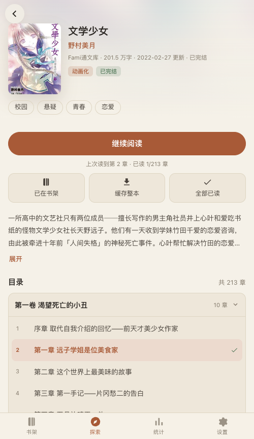
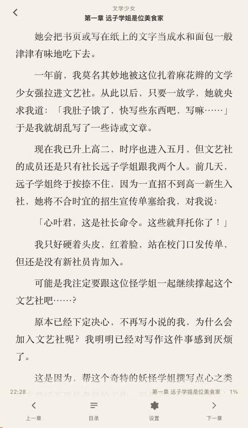
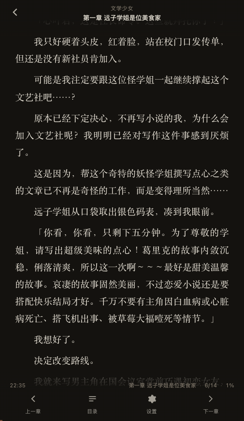
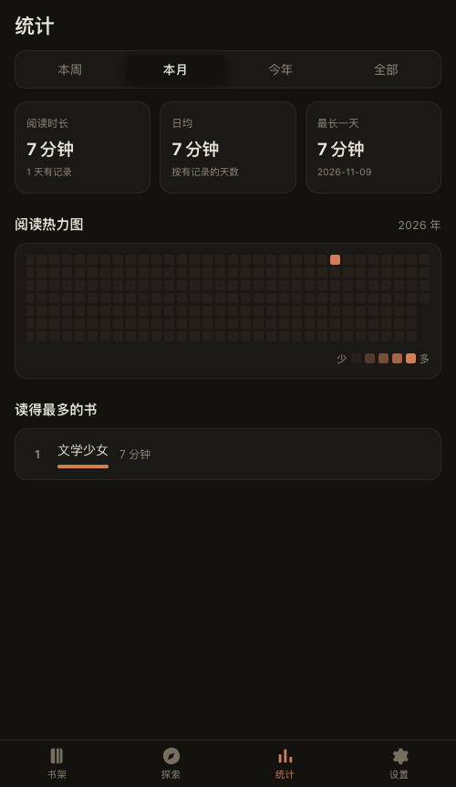
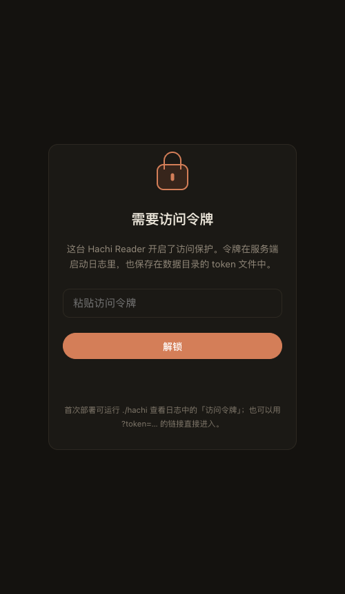
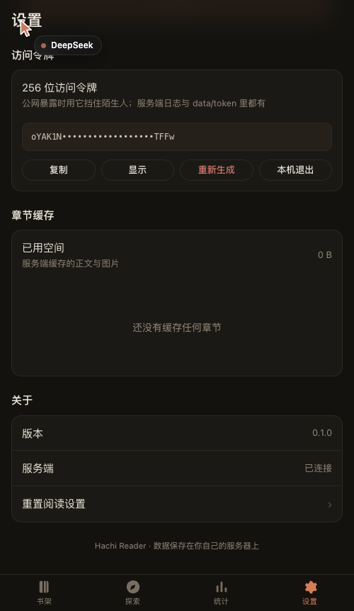

# Hachi Reader

在 iOS（以及任何现代浏览器）上舒适阅读 [轻小说文库 wenku8](https://www.wenku8.net) 的自托管阅读器。

一个 Go 二进制：内嵌前端、服务端抓取与缓存、SQLite 持久化、可安装为 PWA。

```
┌──────────────────────────────┐
│  iPhone Safari / 主屏幕 PWA  │
│  · 书架 · 探索 · 阅读器       │
└──────────────┬───────────────┘
               │ HTTPS
┌──────────────▼───────────────┐
│        hachi (Go, 单文件)     │
│  API · 静态资源(embed)        │
│  抓取层(浏览器指纹伪装)        │
│  SQLite · 图片磁盘缓存         │
└──────────────┬───────────────┘
               │
        wenku8.net (Cloudflare)
```

## 快速开始

```bash
# 需要 Go 1.22+
go build -o hachi ./cmd/hachi

# 开发模式：前端直接读 ./web，改完刷新即可
HACHI_DEV=1 ./hachi -addr :8080 -data ./data

# 生产模式：前端已嵌入二进制
./hachi -addr :8080 -data ./data
```

打开 <http://localhost:8080>。要装到 iPhone 主屏幕，必须通过 **HTTPS** 访问（iOS 只在安全上下文注册 Service Worker），见 [部署文档](docs/deploy.md)。

## 配置

全部通过环境变量，便于 Docker / systemd / launchd / Windows 服务统一注入。

| 变量 | 默认 | 说明 |
|---|---|---|
| `HACHI_ADDR` | `:8080` | 监听地址 |
| `HACHI_DATA` | `./data` | 数据目录（SQLite、图片缓存、凭据） |
| `HACHI_TOKEN` | 自动生成 | 访问令牌。留空时读取 `data/token`，不存在则自动生成 256 位并打印 |
| `HACHI_WK8_USER` | 空 | wenku8 用户名。**探索与搜索必需** |
| `HACHI_WK8_PASS` | 空 | wenku8 密码 |
| `HACHI_WK8_COOKIE` | 空 | 直接注入 Cookie，绕开账号登录（有验证码时用） |
| `HACHI_NO_BUNDLED_COOKIE` | 空 | 设为 `1` 关闭内置公共 Cookie 兜底 |
| `HACHI_NO_AUTH` | 空 | 设为 `1` 关闭令牌校验（仅限可信局域网） |
| `HACHI_PROXY` | 空 | 抓取走的代理，如 `http://127.0.0.1:7890` |
| `HACHI_PROFILE` | `safari_ios` | TLS 指纹：`safari_ios` / `safari` / `chrome` |
| `HACHI_DEV` | 空 | 为 `1` 时前端从磁盘 `web/` 读取且不缓存 |
| `HACHI_TIMEOUT` | `25` | 单次抓取超时（秒） |

命令行参数：`-addr`、`-data`、`-token`、`-no-auth`。

也可以在 App 的「设置 → wenku8 账号」里填账号或 Cookie，会保存到 `data/wenku8.json` / `data/wenku8.cookie`（权限 0600）。**环境变量与参数优先。**

### 访问令牌

首次启动会打印 FIGlet 横幅并生成一个 256 位令牌：

```
   访问令牌: 47lic_tAjkLIj3GEauH4nvNdRAEiHB6cWwb88KRTVoU
```

- 打开网页会看到解锁页，粘贴令牌即可；也可以用 `https://你的域名/?token=…` 直接进入（会自动从地址栏清除）。
- 令牌在「设置 → 访问令牌」里可查看、复制、**重新生成**（旧令牌立即失效）。
- 令牌保存在 `data/token`（0600），忘了就 `cat data/token`。
- 想关掉：`-no-auth` 或 `HACHI_NO_AUTH=1`。

## 界面

| 书架 | 书籍详情 | 阅读器（滚动） |
|---|---|---|
|  |  |  |

| 阅读器（翻页 · 深色） | 阅读统计 | 探索（内置 Cookie 生效） |
|---|---|---|
|  |  |  |

| 访问令牌解锁页 | 令牌管理 |
|---|---|
|  |  |

## 功能

**阅读器**
- 滚动 / 翻页双模式；翻页用 CSS 多列自动分页
- 无痕滚动：滚到章末无缝追加下一章，不跳位
- 点击分区翻页、左右滑动翻页、章末自动跳转
- 返回误触拦截（不拦截 / 双击 / 完全阻止）
- 字号、行距、字距、段首缩进、衬线/无衬线
- 自动边距与手动四边距
- 主题：浅色 / 护眼米黄 / 深色 / 跟随系统，纸张底纹
- 指示器：时间、章节名、阅读进度，可独立开关
- 繁简转换、自定义正则替换规则
- 章节选择面板（按卷分组、已读标记、当前章高亮）
- 阅读进度与时长自动上报

**书库**
- 多书架、排序（默认/最近更新/名称/字数）、固定、反向
- 最近阅读、未读过滤、更新红点
- 书籍详情：分卷目录、已读标记、整本缓存

**发现**
- 排行榜（热门 / 动画化 / 今日更新 / 新书）
- 标签分类（49 个标签）、完结筛选
- 关键词搜索（书名 / 作者）、搜索历史
- 以上均需要 wenku8 登录

**其他**
- 阅读统计：总时长、日历热力图、按书排行
- 章节与图片服务端缓存，离线可读
- PWA：离线外壳、图片缓存、旧章节回退

## 为什么抓取层要伪装浏览器指纹

这不是多余的一层。实测（2026-11）：

- 桌面 Chrome UA 请求 wenku8 直接返回 `403 Just a moment...`（Cloudflare 挑战页）；
- 换成 iPhone Safari UA 后 `curl` 能通，但 **Go 原生 `net/http` 仍然 403**——即使 uTLS 伪装了 TLS 指纹也不行，因为 Cloudflare 还看 HTTP/2 帧指纹与请求头顺序；
- 最终用 [`bogdanfinn/tls-client`](https://github.com/bogdanfinn/tls-client) 完整伪装 Safari iOS 的 TLS + HTTP2 指纹才稳定通过。

细节见 [架构说明](docs/architecture.md)，PWA 侧方案见 [PWA 技术方案](docs/pwa.md)。

## 已知边界

- **探索 / 搜索依赖登录态**：站点对列表页做了登录限制，未登录返回"本站正式关闭"的提示页。默认使用 LightNovelReader 项目内置的公共 Cookie 兜底（可能随时失效），可用自己的账号或 Cookie 覆盖。
- **iOS 无法读取电量**，所以阅读器只提供时间/章节/进度指示器。
- **屏幕常亮**依赖 Wake Lock API，iOS Safari 支持不稳定，不支持时静默降级。
- **阅读器未在真机 iOS 上验证**（开发环境为 macOS + Chromium），安全区与手势冲突建议装机后重点回归。
- 本书不存储任何书籍文件，所有内容实时来自 wenku8，仅做本地缓存加速。

## 目录结构

```
cmd/hachi/         入口
internal/api/      HTTP 接口、静态托管、图片代理
internal/wkk/      wenku8 抓取与解析（含离线测试夹具）
internal/store/    SQLite 持久化
internal/config/   环境变量与凭据
web/               前端（原生 ES 模块，无构建步骤）
  js/core/         路由、API、状态、DOM 工具
  js/views/        书架 / 探索 / 搜索 / 详情 / 统计 / 设置
  js/reader/       阅读器内核
docs/              API 契约、架构、部署
deploy/            systemd / launchd / Windows / Caddy / compose
```

## 测试

```bash
go test ./...                                  # 离线单测（解析夹具 + 存储）
HACHI_LIVE=1 go test ./internal/wkk/ -run Live  # 联网集成测试
```

## 许可

仅供个人学习与自用。书籍版权归原作者与出版社所有，请支持正版。
